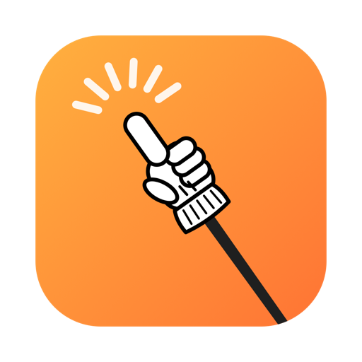
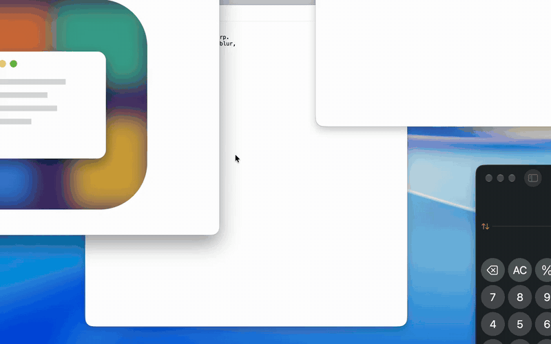

<p align="center"></p>

<h1 align="center">Tapper <sub>敲黑板</sub></h1>

<p align="center">
  Turn your mouse pointer into a cartoon glove on a long stick.<br>
  For demos, screen shares and recordings. Nobody misses where you point.<br>
  A free, open-source macOS menu-bar app.
</p>

<p align="center">
  <a href="https://github.com/iamzifei/tapper/releases/latest/download/Tapper.dmg"><b>Download Tapper.dmg</b></a> ·
  <a href="https://jamesai.dev/tapper/"><b>Try it in your browser</b></a> ·
  <a href="README.zh-CN.md">中文</a>
</p>

<p align="center">
  <a href="https://jamesai.dev/tapper/"></a><br>
  <sub>▶ <a href="docs/assets/tapper-demo.mp4">Full-quality video (MP4)</a> · or <a href="https://jamesai.dev/tapper/">play with it live</a> on the website</sub>
</p>

## What it does

- **A glove instead of an arrow.** The system arrow is hidden on every display. A white cartoon glove follows your pointer. The long stick hangs off toward the bottom-right, fades out at the far end, and swings on a spring as you move.
- **Click to poke.** The glove jabs forward and comic impact lines burst around the fingertip. Click fast and the hits get bigger.
- **Three hands.** *Tiny hand* (pointing finger), *Cat paw* (pink beans included) and *Middle child* (use responsibly).
- **Pointer mood.** Five steps from *Shy finger* to *In your face*: size, stick length and how hard it pokes.
- **Stick colours, knock sound, volume,** and an *Animate on click* switch.
- **Presentation mode.** Clicks only poke and never reach the app underneath, while the keyboard keeps working. Good for pointing at slides without clicking through them.
- **Multiple displays,** and it shows up in screen shares and recordings.

## Shortcuts

| Action | Default |
|---|---|
| Show / hide the pointer | ⌃⌥P |
| Presentation mode | ⌃⌥T |

Everything else is in the menu-bar menu: mood slider, hand style, colour, sound, launch at login.

## Automation

```sh
open -g tapper://toggle          # also: show, hide, poke, presentation
open -g "tapper://set?style=paw&mood=3&color=6&sound=off"
```

`style` is `tiny`, `paw` or `middle`. `mood` goes from 0 to 4. `color` is a number from 0 to 7, in this order: black, white, orange, red, pink, purple, blue, green. `sound` and `animate` take `on` or `off`.

## Install

1. Download [Tapper.dmg](https://github.com/iamzifei/tapper/releases/latest/download/Tapper.dmg), open it, and drag **Tapper** to Applications.
2. Launch it, click the hand in the menu bar, and choose **Show pointer** (or press ⌃⌥P).

Requires macOS 14 Sonoma or later. Universal binary (Apple Silicon + Intel).

**Permissions.** None for the glove. Presentation mode needs *Accessibility* so it can stop clicks from reaching apps; Tapper asks the first time you turn it on. Tapper never records your screen or keystrokes.

> If macOS says it can't verify the developer, right-click Tapper in Applications and choose **Open**. You only need to do this once.

## Build from source

```sh
git clone https://github.com/iamzifei/tapper && cd tapper
scripts/build.sh            # builds, ad-hoc signs, installs to /Applications
scripts/build.sh release    # Developer ID signing + DMG (maintainers)
```

Swift 5.9+, no third-party dependencies. The glove is vector art drawn with Core Graphics (`Sources/Tapper/Art.swift`). `tools/main.swift` renders the app icon and the website sprites from the same code.

## How it works

One transparent, click-through window per display sits above everything. Inside it, a Core Animation layer tree holds the stick and the glove. The far end of the stick is a point mass on a damped spring, and the rig is rotated toward it every frame (120 Hz), which is where the swing comes from. The real cursor is hidden with `CGDisplayHideCursor` for all displays. A background app is normally not allowed to hide the cursor, so Tapper sets the window-server connection property `SetsCursorInBackground`. It also re-checks about 20 times a second, because other apps can show the cursor again, for example after you type.

## License

[MIT](LICENSE) © 2026 Zifei Gong · made by [James](https://jamesai.dev)
