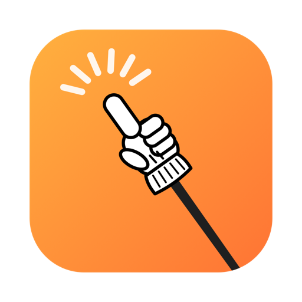
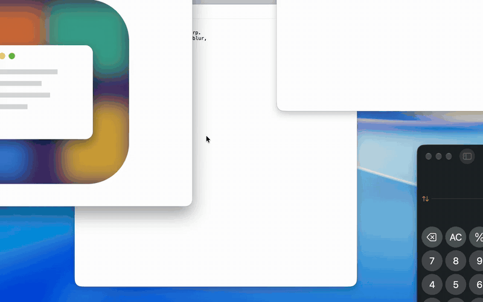

<p align="center"></p>

<h1 align="center">敲黑板（Tapper）</h1>

<p align="center">
  把鼠标指针变成一只插在长杆上的卡通白手套。App 名叫 Tapper。<br>
  演示、共享屏幕、录教程时，大家一眼就知道你在指哪儿。<br>
  免费、开源的 macOS 菜单栏小工具。
</p>

<p align="center">
  <a href="https://github.com/iamzifei/tapper/releases/latest/download/Tapper.dmg"><b>下载 Tapper.dmg</b></a> ·
  <a href="https://jamesai.dev/tapper/"><b>在浏览器里直接试</b></a> ·
  <a href="README.md">English</a>
</p>

<p align="center">
  <a href="https://jamesai.dev/tapper/"></a><br>
  <sub>▶ <a href="docs/assets/tapper-demo.mp4">高清视频（MP4）</a> · 或到 <a href="https://jamesai.dev/tapper/">官网</a> 上直接动手试</sub>
</p>

## 它做什么

- **手套代替箭头**：所有显示器上的系统箭头都隐藏，一只白手套跟着你的指针走。长杆从右下方伸进来，末端渐隐，移动时像弹簧一样晃。
- **点击 = 戳一下**：手往前一戳，指尖周围爆出漫画式的放射线；点得越快，效果越夸张。
- **三种手型**：Tiny hand（食指）、Cat paw（猫爪，带粉色肉垫）、Middle child（中指，慎用）。
- **力度五档**：从「Shy finger」到「In your face」，手的大小、杆的长度、戳的力度一起变。
- **杆的颜色、敲击声和音量**，以及「点击时动画」开关。
- **演示模式**：点击只会戳，不会传给下面的 App；键盘照常能用。指着幻灯片讲的时候不会误点。
- **多显示器**都能用，共享屏幕和录屏里也看得到。

## 快捷键

| 操作 | 默认 |
|---|---|
| 显示 / 隐藏手套 | ⌃⌥P |
| 演示模式 | ⌃⌥T |

其余设置都在菜单栏菜单里：力度滑杆、手型、颜色、声音、开机启动。

## 自动化

```sh
open -g tapper://toggle          # 还有 show, hide, poke, presentation
open -g "tapper://set?style=paw&mood=3&color=6&sound=off"
```

`style` 填 `tiny` / `paw` / `middle`；`mood` 填 0–4；`color` 填 0–7，依次是黑、白、橙、红、粉、紫、蓝、绿。

## 安装

1. 下载 [Tapper.dmg](https://github.com/iamzifei/tapper/releases/latest/download/Tapper.dmg)，打开后把 **Tapper** 拖进「应用程序」。
2. 打开它，点菜单栏里的小手，选 **Show pointer**（或按 ⌃⌥P）。

需要 macOS 14 或更新版本，Apple 芯片和 Intel 都支持。

**权限**：手套本身不需要任何权限。演示模式要拦住点击，需要「辅助功能」权限，第一次打开时会提示你授权。Tapper 不录屏，也不记录按键。

已用 Developer ID 签名，并通过 Apple 公证。

## 从源码构建

```sh
git clone https://github.com/iamzifei/tapper && cd tapper
scripts/build.sh
```

Swift 5.9+，没有第三方依赖。

## 许可

[MIT](LICENSE) © 2026 Zifei Gong · 作者 [James](https://jamesai.dev)
